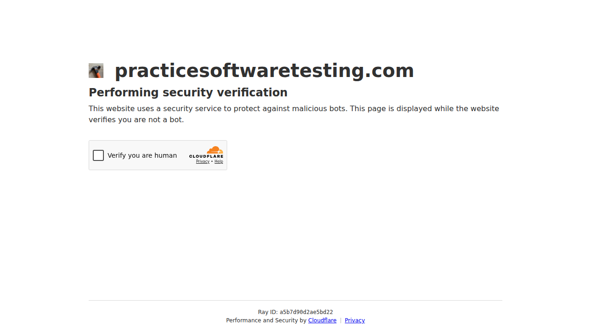

# CI-001: Cloudflare challenge blocks Playwright tests on GitHub Actions

| Field | Details |
| --- | --- |
| Reported | 16 November 2026 |
| Status | Mitigation implemented and verified locally; GitHub verification pending |
| Classification | CI environment / access to the public test application |
| Suggested severity | High: all eight browser tests are blocked |
| Application | https://practicesoftwaretesting.com/ |
| Workflow | [Playwright tests](.github/workflows/tests.yml) |

## Summary

The Playwright suite passes locally, but all eight tests fail on the GitHub-hosted Ubuntu runner. The captured pages show a Cloudflare security verification screen with a "Verify you are human" checkbox instead of the Toolshop application. Tests then fail on the page title or time out waiting for application elements.

This blocks CI regression testing. The evidence establishes an access problem; it does not establish a functional defect in Toolshop.

## Environment

- CI: GitHub Actions, `ubuntu-24.04` runner.
- Language: Go, configured from `go.mod` (`1.26.1`).
- Browser library: `github.com/mxschmitt/playwright-go`, version `v0.6201.1`.
- Browser: Chromium, using the default headless launch configuration.
- Execution: full suite, sequential execution, test-result caching disabled.
- Evidence capture: screenshot, HTML, URL and title on failure; CI artifacts retained for seven days.

## Steps to reproduce

1. Check out the SIS2 repository on a GitHub-hosted Ubuntu runner.
2. Set up the Go version specified in `go.mod`.
3. Download dependencies:

   ```bash
   go mod download
   ```

4. Install Chromium and its Linux dependencies:

   ```bash
   go run github.com/mxschmitt/playwright-go/cmd/playwright@v0.6201.1 install --with-deps chromium
   ```

5. Run the tests against the public application:

   ```bash
   time go test ./... -v -count=1 -parallel=1
   ```

6. Inspect the failed job and download its `failure-evidence` artifact.

The existing workflow performs these steps on a push or pull request and also supports manual execution.

## Expected result

The browser reaches the Toolshop application and executes the intended test flows. The homepage title contains `Practice Software Testing`, and application elements such as the registration and login fields are available for interaction.

## Actual result

The captured pages display `Performing security verification` and a Cloudflare human-verification checkbox. The page title is `Just a moment...`.

Representative errors from the supplied CI log:

```text
TestHomePageLoads:
  Page title expected to be 'Practice Software Testing'
  Actual value: Just a moment...

TestRegisterNewCustomer:
  playwright: timeout: Timeout 30000ms exceeded.
  waiting for getByTestId('first-name')

TestCompareTwoProducts:
  playwright: timeout: Timeout 30000ms exceeded.
  waiting for getByRole('heading', { name: 'Combination Pliers', exact: true })
```

All eight tests failed in the supplied log:

- `TestHomePageLoads`
- `TestCompareTwoProducts`
- `TestRegisterNewCustomer`
- `TestLoginWithValidCredentials`
- `TestLoginWithInvalidPassword`
- `TestResetPasswordWithKnownEmail`
- `TestResetPasswordWithUnknownEmail`
- `TestBuyProduct`

The initial failed run took **242.172 seconds** for the test package and **4 minutes 4.580 seconds** for the full command. The earlier local run passed all eight tests in **37.245 seconds** for the test package and **39.675 seconds** overall. These are observations from different environments, not a valid before/after performance comparison.

## Evidence

Both inspected screenshots, for the homepage and registration test, show the Cloudflare verification screen. All eight supplied HTML files contain Cloudflare challenge markers, including `/cdn-cgi/challenge-platform/`, `cf-chl` and `turnstile`.

A representative screenshot and its unmodified HTML snapshot are preserved with this report:



- [Homepage screenshot](bug-reports/CI-001/homepage.png)
- [Homepage HTML snapshot](bug-reports/CI-001/homepage.html)
- Original evidence bundle: the downloaded `failure-evidence` artifact, with one directory per failed test.

The GitHub Actions run URL and failing commit SHA were not supplied with the evidence.

## Diagnosis

**Confirmed:** Cloudflare serves a challenge page to the CI browser, preventing the failing tests from reaching the application elements they need.

**Unknown:** the specific Cloudflare rule or signal responsible. The evidence does not determine whether runner IP reputation, browser characteristics, rate limiting or another rule triggered the challenge.

## Proposed resolution

Run the Toolshop Sprint 5 application, API and database in Docker within the CI environment, then execute the tests against that controlled instance. The application's [official Docker instructions](https://github.com/testsmith-io/practice-software-testing#using-the-docker-containers) document a local UI at `http://localhost:4200` and API at `http://localhost:8091`.

Implementation steps:

1. Introduce a `BASE_URL` setting and use it in both page navigation and URL assertions.
2. Start a pinned version of the application stack in CI and wait for the UI and API to be ready.
3. Set `BASE_URL` to the local UI address for the CI test step.
4. Run the full suite and retain failure evidence.
5. Document the environment and the reason for using a local application instance.

The workflow now implements this mitigation with a pinned source checkout, an isolated Docker Compose project, and readiness probes. Local verification on 21 November 2026 passed all eight tests in both one-shard and four-shard modes. The public application's Cloudflare behavior has not been changed. A GitHub-hosted run is still required before closing this report. See the README's CI section for reproduction commands and the remaining hosted evidence.

## Acceptance criteria

- A fresh CI run provisions the application and runs the complete suite without manual browser interaction or reliance on the developer's laptop.
- All eight tests reach their intended application pages and pass against the selected application version.
- Navigation and URL assertions consistently use the configured base URL.
- An intentional assertion failure still fails the job and produces downloadable failure evidence retained for at least seven days.
- The README documents how to select the test environment and reproduce the CI run.
